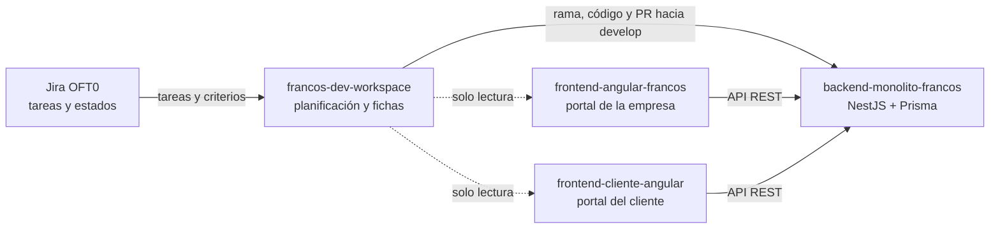
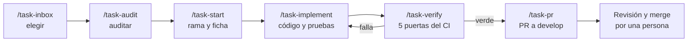

# francos-dev-workspace

Plano de control de mi trabajo en el proyecto OFT0 (Francos). No contiene código
de producto: reúne la planificación, las fichas por incidencia y los agentes y
comandos de Claude Code con los que entrego cada tarea de Jira.

Soy el desarrollador **backend**. Trabajo en `backend-monolito-francos`; los
frontends solo se leen para entender sus contratos de API.

## Cómo se trabaja una tarea

Claude Code se abre desde la raíz de este repo. Una subtarea es una rama y un PR.

`/sync` reconcilia Jira, GitHub y las fichas. `/estado` muestra dónde estoy.

## Estado al 2026-11-10

| Estado | Subtareas |
| --- | --- |
| Listo | 12: `357`, `409`, `473`, `485`, `493`, `521`, `529`, `537`, `557`, `577`, `581`, `586` |
| Por hacer | `573`, `582` |
| Por eliminar | `583`, `584`: pasos de QA descartados |

Detalle y PR de cada una en
[`planificacion/backlog-asignado.md`](planificacion/backlog-asignado.md).

## Reglas principales

- Las ramas salen de `develop` y los PR vuelven a `develop`. `main` no se usa.
- No se abre un PR sin pasar `/task-verify` en verde.
- El merge lo hace una persona en GitHub; ningún agente fusiona.
- Nunca se suben `.env`, secretos, `dist/`, caches ni logs.
- Toda afirmación sobre el código lleva evidencia; un supuesto se marca como tal.

## Dónde está cada cosa

| Ruta | Contenido |
| --- | --- |
| [`CLAUDE.md`](CLAUDE.md) | Reglas completas que carga Claude Code |
| [`planificacion/`](planificacion/) | Backlog y sprints |
| [`specs/`](specs/) | Una ficha por incidencia, desde `TEMPLATE.md` |
| [`orchestration/task-lifecycle.md`](orchestration/task-lifecycle.md) | Ciclo completo y permisos |
| [`context/qa.md`](context/qa.md) | Pipeline de QA |
| [`context/repos.md`](context/repos.md) | Repos, scripts y variables de entorno |
| [`context/equipo.md`](context/equipo.md) y [`context/jira.md`](context/jira.md) | Equipo, tablero y trampas conocidas |
| [`context/agentes-y-skills.md`](context/agentes-y-skills.md) | Agentes, skills y comandos |
| [`context/instalacion.md`](context/instalacion.md) | Instalación y comprobación del entorno |
| [`reportes/`](reportes/) | Registro de entregas |
