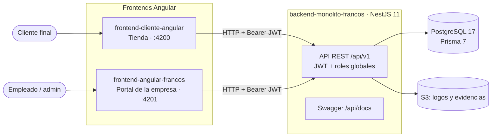
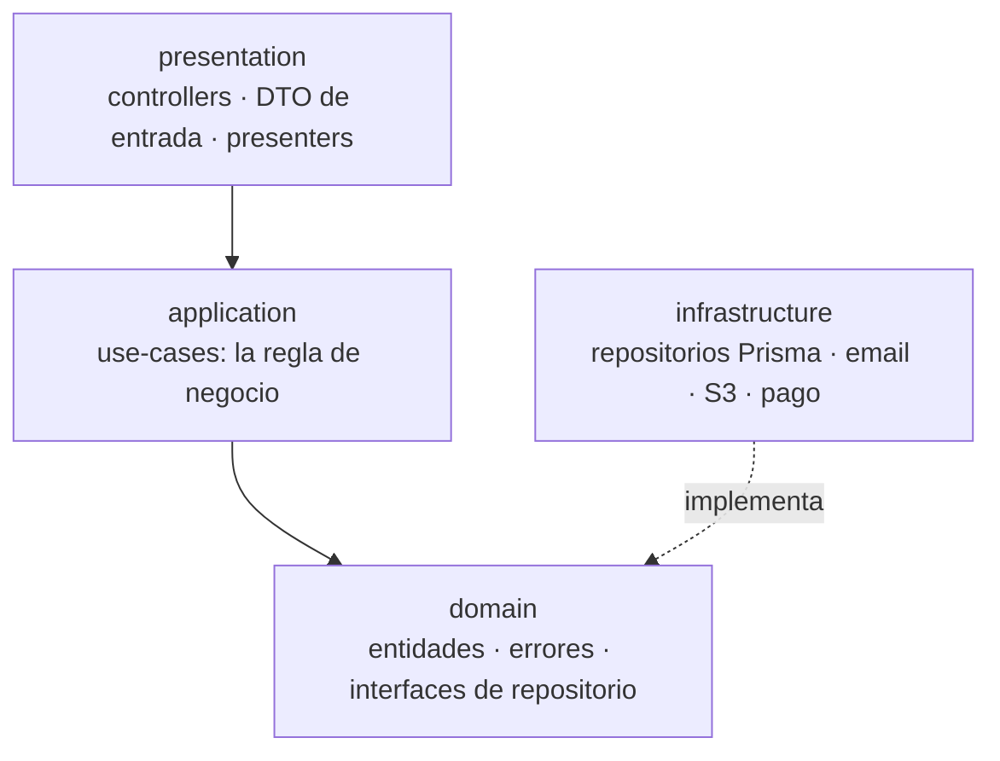
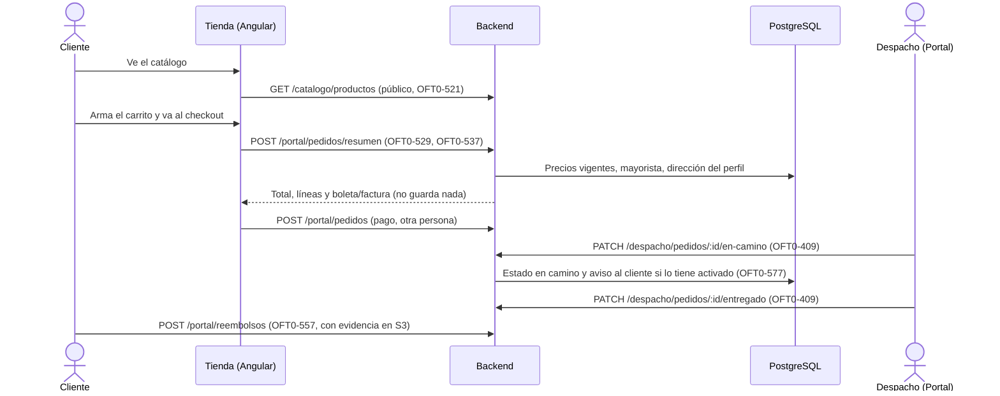
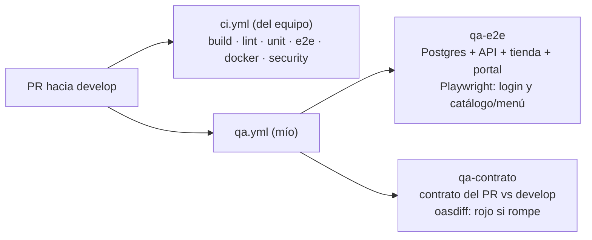

# Guía de defensa: mi participación en Francos

Para estudiar y explicar qué hice, cómo encaja en los tres repos y cómo
responder preguntas. Datos verificados el 2026-11-12 con `gh pr list` y
`git log origin/develop --author=marksato13`.

## 1. En una frase

Soy el desarrollador backend del proyecto: hice **8 funcionalidades de
backend** (empresa emisora, usuarios internos, series de comprobantes, catálogo
público, despacho, resumen del carrito, comprobante, reembolsos y preferencias
de notificaciones) y **el pipeline de QA** que prueba los tres repos juntos en
cada PR.

| Dato | Valor |
| --- | --- |
| PRs fusionados en `backend-monolito-francos` | 11 (más #117 en revisión) |
| Líneas añadidas en esos 11 PRs | ~13 600 |
| PRs fusionados por persona en el repo | PieroLan 28 · bersdecker 23 · Andr3sChavarr1 17 · JoelRM1408 14 · **marksato13 11** · joshua12cx 4 · Pamelavallejos2005 1 |
| Frontends | No los edito: son de otras personas. Los leo para saber qué contrato consumen. |

## 2. Los tres repos y cómo se hablan

- Los dos frontends llaman a `environment.apiUrl` (en local
  `http://localhost:3000/api/v1`) y mandan el token en
  `Authorization: Bearer …` mediante un interceptor de Angular.
- El backend solo acepta peticiones de esos dos orígenes por CORS
  (`FRONTEND_STORE_URL` y `FRONTEND_PORTAL_URL`, en `src/main.ts`).
- **Tienda:** catálogo, carrito, checkout y cuenta. Rol `cliente`.
- **Portal:** configuración, ventas, inventario, producción y gestión
  estratégica. Roles internos (`admin`, `ventas`, `despacho`…).

## 3. Cómo está hecho el backend por dentro

Es un **monolito modular**: un solo despliegue, dividido en 7 módulos de
negocio (`auth`, `persons`, `catalog`, `sales`, `inventory`, `production`,
`strategic`). Cada módulo tiene las mismas 4 capas (arquitectura limpia):

- **presentation** recibe HTTP, valida el DTO (`class-validator`, con
  `whitelist` y `forbidNonWhitelisted`: un campo que sobra da 400) y llama a un
  caso de uso.
- **application** tiene un *use case* por acción (`crear-…`, `listar-…`). No
  sabe nada de HTTP ni de Prisma.
- **domain** define qué necesita guardar o leer, como interfaz
  (`PedidoRepository`), y los errores de negocio (`ResourceNotFoundError` → 404).
- **infrastructure** implementa esa interfaz con Prisma (`PrismaPedidoRepository`).

**Por qué así:** el caso de uso se prueba con Jest sin base de datos (se le pasa
un repositorio falso), y se puede cambiar Prisma sin tocar la regla de negocio.

**Seguridad:** dos guards globales. `JwtAuthGuard` exige token salvo en
`@Public()`, y `RolesGuard` **deniega por defecto** si el endpoint no declara
`@Roles(...)`. Por eso todo endpoint mío lleva su rol.

## 4. Un pedido de punta a punta (mi parte del flujo de venta)

Ejemplo concreto para explicar las capas, con el resumen del carrito:

1. `portal-pedidos.controller.ts`: `POST portal/pedidos/resumen`, `@Roles('cliente')`.
2. `ResumenPedidoPortalDto` valida el body: items, tipo de entrega, comprobante.
3. `resumir-pedido-portal.use-case.ts`:
   - busca al cliente del usuario del token (404 si no existe, 409 si está inactivo);
   - recalcula cada línea con el precio vigente y el precio mayorista;
   - valida el RUC si pide factura.

   No guarda nada: solo calcula.
4. `prisma-pedido.repository.ts` lee precios y perfil con Prisma.
5. Lo prueban `test/portal-pedidos.e2e-spec.ts` (15 casos de 400, 401, 403,
   404 y 409) y el `.spec.ts` del caso de uso.

## 5. Mis ramas, una por una

| PR | Rama | Qué hace | Endpoints (rol) | Lo usa |
| --- | --- | --- | --- | --- |
| #38 | `feature/OFT0-473-gestionar-datos-empresa` | Datos y logo de la empresa que emite los comprobantes. Migración `es_emisora`. | `GET/PUT /empresa`, `POST/DELETE /empresa/logo` (admin) | Portal (`/empresa`) |
| #39 | `feature/OFT0-485-gestionar-usuario-interno` | Alta, edición, activación y roles de los empleados. | `/usuarios` CRUD, `PUT /usuarios/:id/roles` (admin) | Portal (`/usuarios`) |
| #40 | `feature/OFT0-493-gestionar-series-comprobantes` | Series de boleta/factura, correlativo y alertas cuando se agota. Migración nueva. | `/series-comprobante` CRUD y `GET /series-comprobante/alertas` (admin) | Portal (`configuracion/comprobantes`) |
| #46 | `feature/OFT0-521-consultar-catalogo-productos` | Catálogo público para la tienda, con límite de peticiones por IP. | `GET /catalogo/productos`, `GET /catalogo/productos/:id` (público) | Tienda (`/catalogo`) |
| #49 | `feature/OFT0-409-procesar-pedidos-para-entrega` | Bandeja de despacho, indicadores y estados en camino/entregado. Rol `despacho` y fecha de entrega por migración. | `/despacho/pedidos` (admin, despacho) | Todavía sin pantalla en el portal |
| #53 | `feature/OFT0-529-crear-pedido-mediante-carrito` | Resumen del carrito: precios vigentes y mayorista, sin guardar. | `POST /portal/pedidos/resumen` (cliente) | Tienda (checkout) |
| #55 | `feature/OFT0-557-solicitar-reembolso` | El cliente pide un reembolso con evidencia (archivo a S3) y lo consulta. Rechaza tipos de archivo no admitidos. | `POST/GET /portal/reembolsos`, `GET /portal/reembolsos/:id` (cliente) | Todavía sin pantalla en la tienda |
| #80 | `feature/OFT0-537-seleccionar-tipo-comprobante` | Boleta o factura en el resumen; valida el RUC (dígito verificador) y propone los datos del perfil. | Mismo `POST /portal/pedidos/resumen` | Tienda (checkout) |
| #111 | `feature/OFT0-577-preferencias-notificaciones` | El cliente apaga o enciende el aviso de «pedido en camino». Migración en `User`. | `GET/PATCH /portal/notificaciones/preferencias` (cliente) | Todavía sin pantalla en la tienda |
| #103 | `feature/OFT0-581-qa-entorno-humo` | Pipeline de QA: base, API y tienda efímeras en el runner, más Playwright. | — | CI |
| #114 | `feature/OFT0-586-qa-portal-empresa` | El QA también compila y prueba el portal de la empresa. | — | CI |
| #117 | `feature/OFT0-582-qa-contrato-api` | Detecta en cada PR si la API rompe el contrato que usan los frontends. | — | CI (en revisión) |

El PR #6 (`OFT0-55`, gestionar producto) se cerró sin fusionar: **no cuenta**.

## 6. El QA que monté

- **Qué protege:** que un cambio en el backend no deje sin funcionar la tienda
  o el portal, cosa que los e2e de Jest no ven porque no levantan los frontends.
- **Efímero:** todo corre en el runner de GitHub y se destruye al terminar.
  Nunca toca AWS ni datos reales.
- **Informativo:** no es un check obligatorio de `develop` hasta que el equipo
  acuerde hacerlo obligatorio.
- **Probado en rojo a propósito:** con la contraseña del admin rota, el QA del
  portal falla; con una ruta renombrada, `qa-contrato` falla. Una prueba que
  nunca se vio fallar no demuestra nada.

## 7. Preguntas probables y cómo responder

**¿Por qué NestJS y no Express a secas?** Da módulos, inyección de
dependencias, guards y validación de DTO de serie. En un monolito con 7 módulos
y varios desarrolladores, eso impone una misma forma de trabajar.

**¿Por qué un monolito y no microservicios?** Un solo equipo, una sola base y
un solo despliegue: los microservicios sumarían red, versiones y despliegues
sin un beneficio real a este tamaño. Los módulos dejan la puerta abierta a
separar uno después.

**¿Cómo evitas que un cliente vea el pedido de otro (IDOR)?** El id del cliente
nunca viene del body: sale del token (`@CurrentUser`). Las consultas filtran
por ese usuario, y si el recurso es de otro se responde **404, no 403**, para
no revelar que existe. Hay e2e que lo prueban, por ejemplo
`portal-reembolsos.e2e-spec.ts:691`.

**¿Qué pasa si mandan datos basura?** El `ValidationPipe` global rechaza
campos que sobran o tipos malos con 400 antes de llegar al caso de uso. Por
ejemplo, mandar `cliente_id` en el resumen da 400.

**¿Cómo manejas los cambios de base de datos?** Con migraciones de Prisma
versionadas en `prisma/migrations/`. Van en el mismo PR que el cambio de
`schema.prisma`, y el CI las aplica con `migrate deploy` sobre una base limpia.

**¿Cómo trabajan en equipo sin pisarse?** Una subtarea de Jira = una rama = un
PR hacia `develop`. Otra persona revisa y fusiona, y el CI tiene que estar en
verde. Nadie sube directo a `develop` ni a `main`.

**¿Por qué el resumen del carrito no guarda nada?** Porque el precio puede
cambiar y el pedido solo debe nacer cuando se paga. El resumen recalcula todo
en el servidor: nunca se confía en el precio que manda el navegador.

**¿Por qué 3 endpoints tuyos no tienen pantalla?** El backend se entregó antes
que el frontend. Los frontends son de otras personas, y el contrato ya está
documentado en Swagger para que lo consuman.

## 8. Lo que tienes que poder hacer en vivo

1. Abrir `http://localhost:3000/api/docs` y mostrar tus endpoints en Swagger.
2. Recorrer el código de un endpoint tuyo: controller → use case → repositorio
   (el del resumen es el mejor ejemplo).
3. Mostrar un test e2e tuyo y correrlo (`pnpm test:e2e -- portal-pedidos`, con
   PostgreSQL arriba y las variables de `context/instalacion.md`).
4. Abrir un PR tuyo en GitHub y explicar su CI en verde.
5. Abrir el run de `qa-e2e` y su reporte de Playwright.

## 9. Sé honesto con esto

- Usé asistentes de IA para programar. Lo defendible es que **entiendes cada
  decisión**: repasa las secciones 3 y 4 hasta poder explicarlas sin leer.
- Las piezas transversales no son tuyas: los guards globales (PR #9 y #12), el
  login, el pago con Culqi y la creación del pedido. Úsalas, pero no te las
  atribuyas.
