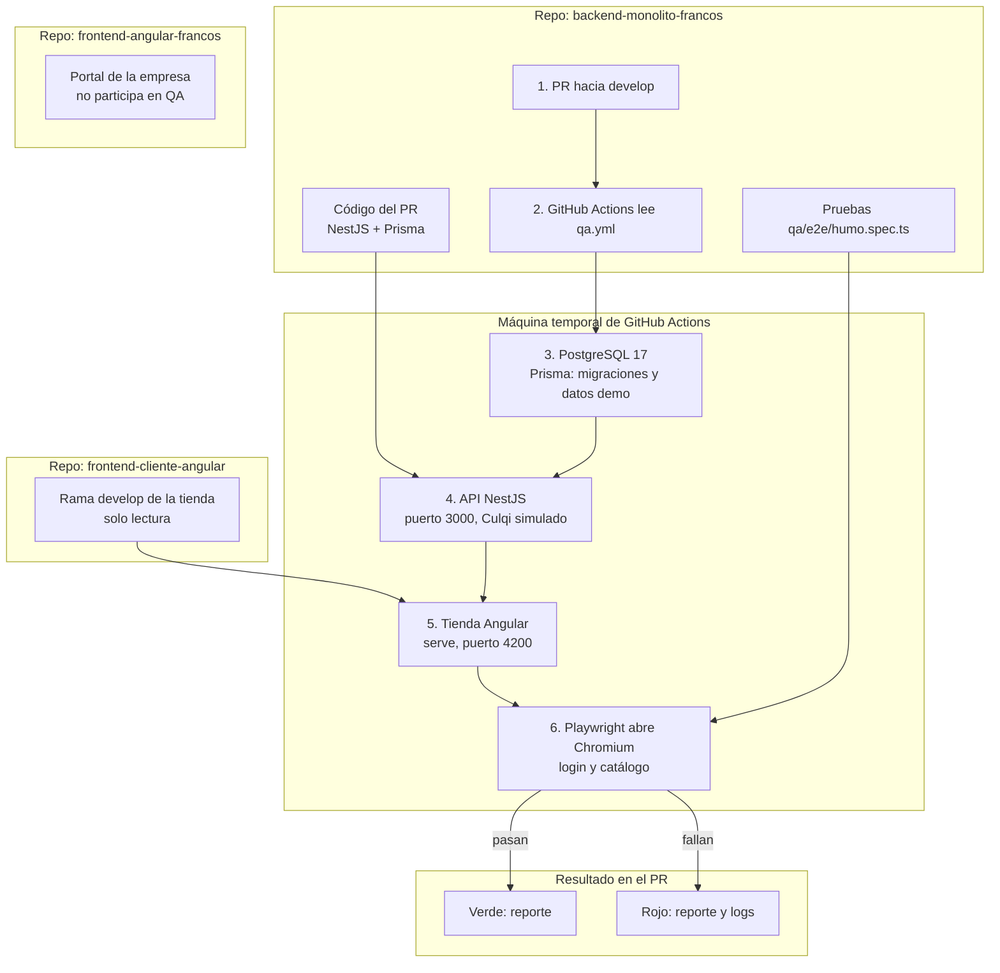

# Pipeline de QA

Entregado por `OFT0-581` en el
[PR #103](https://github.com/Proyecto-Aura/backend-monolito-francos/pull/103), aún
sin fusionar. El job `qa-e2e` corre en cada PR hacia `develop`, junto al CI
existente. Es informativo: no impide un merge.

## Qué prueba

| Prueba | Qué exige |
| --- | --- |
| Login y catálogo | `cliente_prueba` entra, llega a `/catalogo` y ve un producto que viene de la API real |
| Contraseña incorrecta | La API responde 401, la pantalla muestra «Credenciales inválidas» y sigue en login |

## Límites

- Es una prueba de humo. No cubre carrito, checkout, pagos, seguridad ni carga.
- La tienda se toma de la punta de `develop`; por eso el resumen registra su SHA.
- Lo que no tiene pantalla se prueba con los e2e de Jest del backend.
- Playwright, Jest y `qa-e2e` no consumen tokens de IA.

## Pendiente

`OFT0-582` añade contrato de la API, IDOR y datos inválidos después del merge del
PR #103.
