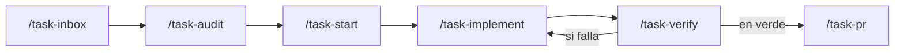
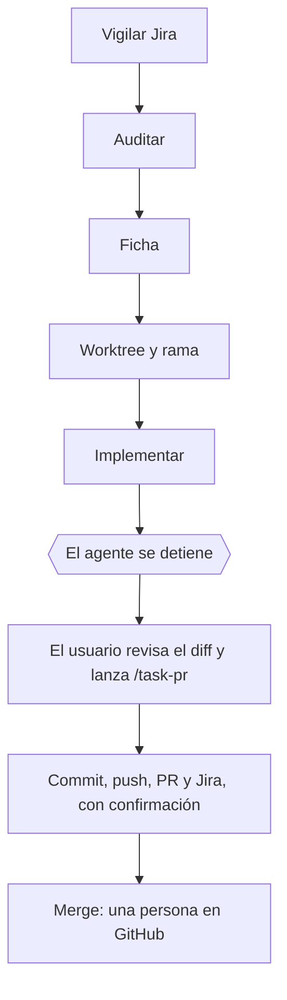

# Ciclo de vida de una subtarea OFT0

Una ejecución trata **una sola** incidencia. Si se mezclan varias, se separan en
ramas y PR independientes.



| Etapa | Comando | Agente | ¿Edita? | ¿Entrega? |
| --- | --- | --- | --- | --- |
| **0 Sincronizar** | **`/sync`** | principal | Solo documentacion | No |
| 0 Bandeja | `/task-inbox` | principal | No | No |
| 1 Auditar | `/task-audit` | `jira-task-auditor` | **No** | No |
| 2 Preparar | `/task-start` | principal | Sí (ficha + rama) | No |
| 3 Implementar | `/task-implement` | `backend-implementer` | Sí | No |
| 4 Verificar | `/task-verify` | `backend-reviewer` | **No** | No |
| 5 Entregar | `/task-pr` | principal | Sí | **Sí, con confirmación** |

`frontend-contract-reader` se invoca desde las etapas 1 y 3 cuando el cambio toca
un contrato de API. Nunca edita.

## Puertas de paso

No se avanza de etapa sin cumplir su puerta:

| Para pasar a | Hace falta |
| --- | --- |
| `/task-start` | La clave existe en Jira y los criterios están descompuestos |
| `/task-implement` | Ficha en `specs/` sin decisiones pendientes de diseño |
| `/task-verify` | Implementación terminada, worktree sin cambios ajenos |
| `/task-pr` | Las 5 puertas del CI en verde (o las omisiones justificadas) |
| Merge | Revisión humana en GitHub |

## Lo que está bloqueado por configuración

Definido en `.claude/settings.json`. En Claude Code **`deny` siempre gana sobre
`allow`**, así que estas reglas no se pueden sortear desde un agente:

**Denegado para todo el mundo**

- Cualquier operación contra `main`: push, checkout, switch, merge, rebase, PR.
- `git push --force`, `git push -f`.
- `git reset --hard`, `git clean`, `git stash`, `git restore` — protegen el
  worktree compartido.
- `gh pr merge`, `gh pr close`, `gh repo delete`, `gh auth`, `gh secret`.
- `prisma migrate reset`, `prisma db push`, `prisma db execute`.
- Leer `.env`, `.env.*` y `docker-compose.override.yml` del backend.
- Escribir en los frontends, en `node_modules/` y en `pnpm-lock.yaml`.
- `docker stop`, `docker rm`, `docker compose down -v` — hay un contenedor
  `persons_database` de otro proyecto que no se debe tocar.
- Crear, editar o borrar incidencias Jira; registrar worklogs; tocar Confluence.

**Pide confirmación**

- `git commit`, `git push`, `git merge`, `git rebase`, `git cherry-pick`.
- `gh pr create`, `gh pr edit`, `gh pr comment`.
- `pnpm lint`, `pnpm format` (reescriben archivos).
- `prisma migrate dev`, `prisma db seed`.
- `docker compose up/down`, `docker build`, `docker run`.

**Automático**

- Lectura de Jira; comentar y transicionar **mis propias subtareas**.
- Todo `git`/`gh` de lectura.
- `pnpm build`, `pnpm test`, `pnpm lint:check`, `pnpm format:check`,
  `prisma generate/validate/migrate status`.

Además, los agentes de solo lectura (`jira-task-auditor`, `backend-reviewer`,
`frontend-contract-reader`) **no tienen las herramientas `Edit` ni `Write` en su
lista blanca**, así que la restricción no depende solo de los patrones de Bash.

## Borrar ramas en un repo compartido

El backend lo tocan **5 personas**, no las 3 que muestra Jira. Antes de borrar
cualquier rama hay que comprobar dos cosas, en este orden:

1. **Que su contenido esta integrado.** Con `git cherry`, que compara por
   contenido y no por SHA (un squash merge cambia el SHA):

   ```bash
   git cherry origin/develop origin/<rama>   # '+' = commit NO integrado
   ```

   No uses `git diff origin/develop...origin/<rama>`: eso muestra lo que la rama
   aporto desde el punto de divergencia, no lo que falta en `develop`.

2. **Quien la escribio.**

   ```bash
   git log origin/develop..origin/<rama> --format='%an %s'
   ```

**Nunca borres una rama con commits sin integrar que no sean tuyos.** Si no tiene
PR detras, el borrado es irrecuperable: reportalo y que lo decida su autor.

Una rama propia con PR cerrado si se puede borrar: GitHub conserva
`refs/pull/<n>/head` de forma permanente, asi que el commit se recupera con
`git fetch origin refs/pull/<n>/head`. Verificalo **antes** de borrar, no despues.

## Orca: un worktree por tarea

Cada subtarea se trabaja en su propio worktree de Orca, para no pisar el checkout principal
ni mezclar dos tareas en el mismo arbol.

```powershell
orca worktree create `
  --repo id:2479e1c5-364c-4d1d-b885-d282a348debc `
  --name OFT0-XXX-slug `
  --no-parent `
  --agent claude `
  --json
```

- **Se omite `--base-branch` a proposito.** El repo tiene `worktreeBaseRef = origin/develop`,
  asi que Orca saca la rama de `develop` sola. Pasarlo a mano es la forma de equivocarse.
- `--no-parent` porque las subtareas son independientes; no se apilan ramas.
- El `worktree.id` que devuelve es `<repoId>::<ruta>` **entero**. Hay que copiarlo completo.

Al avanzar, mantener la tarjeta al dia:

```powershell
orca worktree set --worktree active --workspace-status in-progress --json
orca worktree set --worktree active --comment "CA-1 a CA-4 implementados; faltan pruebas" --json
```

Detalle completo en [`context/orca.md`](../context/orca.md).

## Frontera de autonomia

Decidido el 2026-10-16: **automatico hasta la rama, supervisado desde el commit.**



El agente **nunca** cruza la linea del commit por su cuenta. No es una convencion: en
`.claude/settings.json`, `git commit`, `git push` y `gh pr create` estan en `ask`, y
`gh pr merge` y todo lo que apunte a `main` estan en `deny`.

Motivo: el repositorio lo tocan **6 personas**, el CI tiene 5 puertas con `lint` bloqueante,
y ya hubo una reasignacion de tareas sin aviso. Un agente abriendo PRs sin supervision ahi
produce colisiones, no velocidad.

## Definición de terminado

Una subtarea no está terminada porque compile. Debe:

1. Cumplir todos los criterios `CA-x` marcados como alcance.
2. Tener pruebas del comportamiento nuevo en el mismo PR.
3. Pasar las 5 puertas del CI.
4. Tener PR hacia `develop` con pruebas ejecutadas **y omitidas** declaradas.
5. No introducir riesgos críticos ni dependencias silenciosas con el frontend.
6. Dejar Jira trazable: comentario con el enlace al PR y estado coherente.

*Listo* solo después del merge a `develop` y la verificación final.
